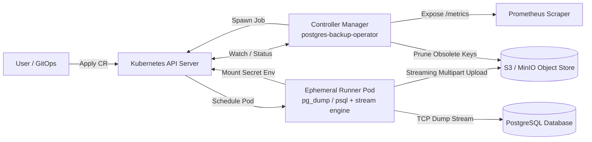

# postgres-backup-operator

[](https://github.com/Xol1ren/postgres-backup-operator/actions/workflows/ci.yml)
[](https://github.com/Xol1ren/postgres-backup-operator/actions/workflows/release.yml)
[](LICENSE)

A production-grade Kubernetes operator that automates **PostgreSQL scheduled backups**, **zero-disk streaming S3/MinIO uploads**, **automated retention pruning**, and **self-service logical restores** via Custom Resource Definitions (`PostgresBackup` and `PostgresRestore`).

- **Zero-Disk Streaming**: `pg_dump` streams through an on-the-fly compressor (`gzip` or `zstd`) directly into S3/MinIO via a bounded multipart upload buffer pool without ever spooling uncompressed dumps to local disk.
- **Isolated Ephemeral Runners**: Each backup and restore operation runs in an ephemeral, strictly sandboxed `batch/v1 Job` pod with non-root security contexts.
- **Automated Retention**: Post-backup retention pruning purges obsolete snapshot objects from S3 based on configured `retentionDays`.
- **First-Class Observability**: Native Prometheus instruments for duration histograms, success/failure counters, and timestamp gauges.

---

## Architecture



```
 [PostgresBackup CR] ──► Controller Manager ──► Spawn Job ──► pg_dump ──► gzip|zstd ──► S3 Multipart
          ▲                       │   ▲                                                      │
          └───── Status Updates ──┘   └──────── Job Succeeded/Failed ────── Retention Prune ─┘

 [PostgresRestore CR] ─► Controller Manager ──► Spawn Job ──► S3 Stream ──► Decompress ──► psql Target
```

### State Machines

- **`PostgresBackup`**:
  `Pending` ──(schedule due)──► `Running` ──(Job complete)──► `Succeeded`
                                           └──(Job failed)────► `Failed`
  After reaching `Succeeded` or `Failed`, the controller re-arms and sleeps until the next cron activation in **UTC**.
- **`PostgresRestore`**:
  `Pending` ──(Job spawned)──► `Running` ──(Job complete)──► `Succeeded`
                                           └──(Job failed)────► `Failed`
  Restores are non-idempotent and execute strictly once to prevent accidental database overwrites (`BackoffLimit: 0`).

---

## PostgreSQL Compatibility Matrix

The runner container is built on top of client tools from PostgreSQL 16 (supporting backward and forward wire protocols):

| PostgreSQL Version | Backup Support | Restore Support | Notes |
|:------------------:|:--------------:|:---------------:|:------|
| **PostgreSQL 17**  | Supported      | Supported       | Compatible via PostgreSQL 16 client library; supports standard catalog queries |
| **PostgreSQL 16**  | Native         | Native          | Fully aligned with runner `pg_dump`/`psql` 16.x |
| **PostgreSQL 15**  | Supported      | Supported       | Full backwards compatibility |
| **PostgreSQL 14**  | Supported      | Supported       | Full backwards compatibility |

---

## Runner Hardening & Security Context

Both operator manager and ephemeral runner jobs adhere to Kubernetes Pod Security Standards (Restricted profile):

```yaml
securityContext:
  runAsNonRoot: true
  runAsUser: 10001
  runAsGroup: 10001
  fsGroup: 10001
  seccompProfile:
    type: RuntimeDefault
containers:
  - name: runner
    securityContext:
      allowPrivilegeEscalation: false
      readOnlyRootFilesystem: true
      runAsNonRoot: true
      runAsUser: 10001
      capabilities:
        drop: ["ALL"]
    volumeMounts:
      - name: scratch
        mountPath: /tmp
volumes:
  - name: scratch
    emptyDir:
      medium: Memory
      sizeLimit: 64Mi
```

### Memory Footprint & Buffer Optimization
- S3 multipart upload uses a bounded buffer pool (`manager.NewBufferedReadSeekerWriteToPool`) with 16 MiB chunk sizes and a concurrency of 3 (maximum ~48 MiB in flight).
- Prevents OOM kills when streaming multi-gigabyte or terabyte database dumps within the 512 MiB Job container memory limit.

---

## Quickstart

### 1. Deploy Operator to Cluster
```bash
# Install CRDs, RBAC, and Deployment
make deploy IMG=ghcr.io/xol1ren/postgres-backup-operator:latest
```

### 2. Configure Credentials
Create secret containing target PostgreSQL connection details and S3 credentials:
```bash
kubectl create secret generic appdb-credentials \
  --from-literal=host=postgres.default.svc.cluster.local \
  --from-literal=port=5432 \
  --from-literal=sslmode=prefer \
  --from-literal=user=postgres \
  --from-literal=password=postgres \
  --from-literal=dbname=appdb

kubectl create secret generic s3-credentials \
  --from-literal=accessKeyId=minioadmin \
  --from-literal=secretAccessKey=minioadmin
```

### 3. Schedule Backups
```bash
kubectl apply -f local-dev/samples/backup_sample.yaml
kubectl get pgb
```

### 4. Perform a Restore
```bash
kubectl apply -f local-dev/samples/restore_sample.yaml
kubectl get pgr
```

---

## Local Development & Automated E2E Verification

Spin up a local sandbox with PostgreSQL 16, MinIO S3, and Prometheus:

```bash
# Start local containers
docker compose -f local-dev/docker-compose.yaml up -d

# Run the end-to-end simulation harness (seeds data, backs up, drops tables, restores, asserts data)
./local-dev/scripts/e2e_test.sh
```

Alternatively, run the operator locally against your current kubecontext:
```bash
make run-local
```

---

## CRD Reference

### `PostgresBackup` (`backup.xol1ren.io/v1alpha1`, shortName: `pgb`)

| Field | Type | Required | Description |
|---|---|:---:|---|
| `spec.databaseUriSecretRef.name` | `string` | Yes | Secret with keys: `host`, `user`, `password`, `dbname`, optional `port` (5432), optional `sslmode` (`prefer`, `require`, etc.) |
| `spec.schedule` | `string` | Yes | Standard 5-field cron expression in UTC (e.g. `0 2 * * *`) or macros (`@daily`) |
| `spec.storage.bucket` | `string` | Yes | Target S3/MinIO bucket name |
| `spec.storage.endpoint` | `string` | No | S3 endpoint URL (e.g. `http://minio:9000`). Omit for AWS S3 |
| `spec.storage.region` | `string` | No | AWS Region (default: `us-east-1`) |
| `spec.storage.prefix` | `string` | No | Object key prefix path |
| `spec.storage.forcePathStyle` | `bool` | No | Force path style (`true` for MinIO/Ceph) |
| `spec.storage.credentialSecretRef.name` | `string` | Yes | Secret with `accessKeyId` and `secretAccessKey` |
| `spec.retentionDays` | `int32` | No | Days to retain backup objects before pruning (default: `7`) |
| `spec.compression` | `string` | No | Algorithm: `gzip` (default) or `zstd` |
| `status.phase` | `string` | - | `Pending`, `Running`, `Succeeded`, `Failed` |
| `status.lastBackupTime` | `date` | - | Completion timestamp of last successful backup |
| `status.backupSize` | `int64` | - | Compressed size in bytes of last successful backup |
| `status.s3Path` | `string` | - | S3 key of latest snapshot (`<prefix>/<ns>/<name>/<timestamp>.sql.(gz\|zst)`) |

### `PostgresRestore` (`backup.xol1ren.io/v1alpha1`, shortName: `pgr`)

| Field | Type | Required | Description |
|---|---|:---:|---|
| `spec.backupName` | `string` | Conditional | Name of `PostgresBackup` in same namespace to restore |
| `spec.s3Path` | `string` | Conditional | Direct S3 key to restore. Requires `spec.storage` |
| `spec.targetSnapshotTime` | `string` | No | RFC3339 timestamp selecting the newest logical snapshot at or before this time |
| `spec.pitrTimestamp` | `string` | No | *Deprecated:* Alias fallback for `targetSnapshotTime` |
| `spec.targetDatabaseUriSecretRef.name` | `string` | Yes | Target database secret (`host`, `user`, `password`, `dbname`, `port`, `sslmode`) |
| `status.phase` | `string` | - | `Pending`, `Running`, `Succeeded`, `Failed` |
| `status.completionTime` | `date` | - | Timestamp when restore reached terminal state |
| `status.error` | `string` | - | Human-readable failure explanation |

---

## Observability & Prometheus Alerts

The operator exposes Prometheus metrics on `:8080/metrics`:

| Metric Name | Type | Labels | Description |
|---|---|---|---|
| `pgbackup_duration_seconds` | Histogram | `namespace`, `name` | Execution duration of backup jobs in seconds |
| `pgbackup_total` | Counter | `namespace`, `name`, `status` (`success` \| `failed`) | Cumulative counter of completed backup jobs |
| `pgbackup_last_timestamp_seconds` | Gauge | `namespace`, `name` | Unix timestamp of most recent successful backup |

### Recommended Alerting Rules

```yaml
groups:
  - name: PostgresBackupAlerts
    rules:
      - alert: PostgresBackupMissing
        expr: (time() - pgbackup_last_timestamp_seconds) > 93600 # 26 hours
        for: 15m
        labels:
          severity: critical
        annotations:
          summary: "PostgreSQL backup is overdue"
          description: "Database {{ $labels.namespace }}/{{ $labels.name }} has not completed a backup in over 26 hours."

      - alert: PostgresBackupJobFailed
        expr: increase(pgbackup_total{status="failed"}[1h]) > 0
        for: 5m
        labels:
          severity: warning
        annotations:
          summary: "PostgreSQL backup job failed"
          description: "One or more backup attempts failed for {{ $labels.namespace }}/{{ $labels.name }}."

      - alert: PostgresBackupHighDuration
        expr: pgbackup_duration_seconds{quantile="0.9"} > 7200 # 2 hours
        for: 10m
        labels:
          severity: warning
        annotations:
          summary: "PostgreSQL backup duration exceeded threshold"
          description: "90th percentile backup duration for {{ $labels.namespace }}/{{ $labels.name }} exceeds 2 hours."
```

---

## Runbook & Troubleshooting

| Symptom | Probable Cause | Corrective Action |
|---|---|---|
| Stays in `Pending` | Waiting for first schedule trigger | Check `status.nextBackupTime` via `kubectl get pgb <name> -o yaml`. |
| `Failed` with `InvalidSchedule` | Invalid cron format | Verify standard 5-field cron syntax in `spec.schedule`. |
| `Failed` with `JobFailed` | `pg_dump` connection or auth error | Inspect job logs: `kubectl logs -n <ns> job/<status.activeJob>`. Verify database password, network policy, and `sslmode`. |
| `RetentionApplied: False` condition | Insufficient S3 permissions | Check that S3 user possesses `s3:ListBucket` and `s3:DeleteObject` on bucket/prefix. |
| Restore `Failed` with "no backup found" | No matching snapshot | Ensure referenced `PostgresBackup` has at least one successful backup object. |

---

## Makefile Targets

```bash
make test         # Run unit & integration tests with race detection
make lint         # Run staticcheck and golangci-lint
make generate     # Regenerate zz_generated.deepcopy.go via controller-gen
make manifests    # Regenerate OpenAPI CRD manifests
make build        # Build local manager and runner binaries
make docker-build # Build multi-stage Docker images
```

---

## License

Apache License 2.0. See [LICENSE](LICENSE) for details.
