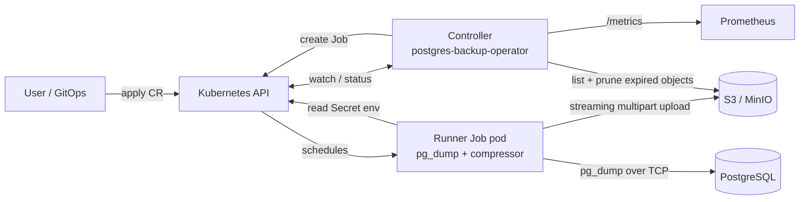

# postgres-backup-operator

A Kubernetes operator that automates **PostgreSQL backups**, **streaming S3/MinIO uploads**, **retention pruning** and **self-service restores** through two CRDs: `PostgresBackup` and `PostgresRestore`.

- `pg_dump` output is compressed (gzip/zstd) **on the fly** and pushed via S3 multipart upload. Nothing is written to local disk.
- Each run is an ephemeral `batch/v1 Job`, so the operator itself never touches your data path.
- Retention pruning runs after every successful backup.
- Prometheus metrics: `pgbackup_duration_seconds`, `pgbackup_total{status}`, `pgbackup_last_timestamp_seconds`.

## Architecture



```
 PostgresBackup ──► Controller ──creates──► Job ─► pg_dump ─► gzip|zstd ─► S3 multipart ─► bucket
        ▲               │  ▲                                                          │
        └─ status ──────┘  └──────── Job complete/failed ───────────  retention prune ┘
 PostgresRestore ─► Controller ──creates──► Job ─► S3 GET ─► decompress ─► psql ─► target DB
```

### Backup state machine

`Pending → Running → Succeeded | Failed`; after a terminal state the controller waits for the next cron tick and goes to `Running` again. Cron is evaluated in **UTC**. The first run happens at the first tick after the resource is created.

Restores are one-shot: `Pending → Running → Succeeded | Failed` (never retried automatically, since a partially applied restore isn't idempotent).

## Quickstart

Prerequisites: a cluster, `kubectl`, an S3-compatible bucket.

```bash
# 1. CRDs, RBAC, operator
make deploy IMG=ghcr.io/xol1ren/postgres-backup-operator:latest

# 2. Secrets (keys are fixed, see reference below)
kubectl create secret generic appdb-credentials \
  --from-literal=host=pg.prod.svc --from-literal=port=5432 \
  --from-literal=user=backup --from-literal=password=... --from-literal=dbname=app
kubectl create secret generic s3-credentials \
  --from-literal=accessKeyId=... --from-literal=secretAccessKey=...

# 3. Schedule backups
kubectl apply -f local-dev/samples/backup_sample.yaml
kubectl get pgb            # PHASE / SCHEDULE / LAST BACKUP / SIZE

# 4. Restore
kubectl apply -f local-dev/samples/restore_sample.yaml
kubectl get pgr
```

The database user for backups needs read access to everything being dumped. The restore target user needs rights to create the objects in the dump (it is plain SQL, produced with `--clean --if-exists --no-owner`).

Build the images yourself with `make docker-build` (manager is a `scratch` image; the runner is `postgres:16-alpine` + the runner binary because it needs `pg_dump`/`psql`).

### Local development

```bash
make tools                                   # controller-gen, staticcheck, golangci-lint into ./bin
docker compose -f local-dev/docker-compose.yaml up -d   # Postgres, MinIO (:9001 console), Prometheus (:9090)
make run-local                               # runs the manager against your current kube context
```

## CRD reference

### `PostgresBackup` (`backup.xol1ren.io/v1alpha1`, short name `pgb`)

| Field | Type | Description |
|---|---|---|
| `spec.databaseUriSecretRef.name` | string | Secret with keys `host`, `user`, `password`, `dbname`, optional `port` (default 5432) |
| `spec.schedule` | string | 5-field cron or `@hourly`/`@daily`... (UTC) |
| `spec.storage.endpoint` | string | S3 endpoint URL; empty = AWS S3 |
| `spec.storage.bucket` | string | Bucket name |
| `spec.storage.region` | string | Default `us-east-1` |
| `spec.storage.prefix` | string | Optional key prefix |
| `spec.storage.forcePathStyle` | bool | Needed for MinIO |
| `spec.storage.credentialSecretRef.name` | string | Secret with `accessKeyId`, `secretAccessKey` |
| `spec.retentionDays` | int | Default 7. Objects older than this under the backup's prefix are deleted after each successful run |
| `spec.compression` | `gzip`\|`zstd` | Default `gzip` |
| `status.phase` | enum | `Pending`, `Running`, `Succeeded`, `Failed` |
| `status.lastBackupTime` | time | Last successful completion |
| `status.backupSize` | int64 | Compressed bytes of the last backup |
| `status.s3Path` | string | Object key of latest/in-flight backup |
| `status.conditions` | list | `Ready`, `RetentionApplied` |

Object key layout: `<prefix>/<namespace>/<name>/<YYYYMMDDTHHMMSSZ>.sql.(gz|zst)`.

### `PostgresRestore` (short name `pgr`)

| Field | Type | Description |
|---|---|---|
| `spec.backupName` | string | A `PostgresBackup` in the same namespace; restores its latest successful backup |
| `spec.s3Path` | string | Explicit object key (requires `spec.storage`). Exactly one of `backupName`/`s3Path` |
| `spec.storage` | StorageSpec | Only for `s3Path` |
| `spec.targetDatabaseUriSecretRef.name` | string | Same secret format as above |
| `spec.pitrTimestamp` | time | With `backupName`: restore the newest backup taken at or before this time |
| `status.phase` / `completionTime` / `error` | | Outcome |

> [!NOTE]
> `pitrTimestamp` has **snapshot granularity**: it picks the closest logical dump, it does not replay WAL. True point-in-time recovery needs WAL archiving, which is out of scope.

## Observability

| Metric | Type | Labels |
|---|---|---|
| `pgbackup_duration_seconds` | histogram | `namespace`, `name` |
| `pgbackup_total` | counter | `namespace`, `name`, `status` (`success`/`failed`) |
| `pgbackup_last_timestamp_seconds` | gauge | `namespace`, `name` |

Served on `:8080/metrics` together with the standard controller-runtime metrics. Example alerts:

```promql
time() - pgbackup_last_timestamp_seconds > 26 * 3600          # no backup in 26h
increase(pgbackup_total{status="failed"}[1h]) > 0              # a backup failed
```

## Troubleshooting

| Symptom | Check |
|---|---|
| Stays `Pending` | Normal until the first cron tick. See `status.nextBackupTime`. |
| `Failed`, reason `InvalidSchedule` | `kubectl describe pgb <name>`; fix `spec.schedule`. |
| `Failed` after a Job ran | `kubectl logs job/<status.activeJob>` (or `kubectl logs -l backup.xol1ren.io/owner=<name>`). Typical: bad DB credentials, network policy blocking Postgres, bucket missing. Failed dumps delete their partial object. |
| `RetentionApplied=False` | The backup succeeded, but listing/deleting failed: check the S3 credentials' `s3:ListBucket`/`s3:DeleteObject` permissions. |
| Restore `Failed`: "no successful backup yet" | The referenced `PostgresBackup` has never succeeded. |
| Job pod `CreateContainerConfigError` | A Secret key is missing (`host`, `user`, `password`, `dbname`, `accessKeyId`, `secretAccessKey`). |
| Jobs OOM | Multipart upload buffers `3 × 16 MiB` plus compressor state; the Job limit is 512 MiB. |
| Controller logs | `kubectl -n postgres-backup-system logs deploy/postgres-backup-operator` |

## Development

```bash
make test       # go test -race -v ./...
make lint       # staticcheck + golangci-lint
make generate manifests   # regenerate deepcopy + CRDs after editing api/
```

Layout: `api/v1alpha1` (types) · `controllers` (reconcilers) · `internal/{schedule,storage,runner,metrics}` · `cmd/{manager,runner}` · `deployments` (CRDs, RBAC, Deployment) · `local-dev`.

## License

Apache-2.0

